# Research Methodology: Traffic-Aware Spatio-Temporal PM2.5 Hotspot Prediction in Hyderabad

**Document Code:** `RM-HYD-PM25-2026-REV2`  
**Project Title:** Traffic-Aware Spatio-Temporal $\text{PM}_{2.5}$ Concentration and Hotspot Forecasting in Hyderabad Using Multi-Source Environmental Data and Explainable Machine Learning  
**Author:** Academic Capstone Research Team  
**Institution:** Department of Computer Science and Engineering  
**Target Publication Venues:** IEEE BigData (Smart Cities Track), ACM SIGSPATIAL, IEEE IGARSS / J-STARS, IEEE TENCON  
**Date:** November 2026 (Revised & Strengthened Pre-Implementation Specification)  
**Document Status:** Approved Pre-Implementation Research Methodology  

---

## 1. Research Problem & Motivation

Ambient particulate air pollution—specifically particulate matter with an aerodynamic diameter $\le 2.5\,\mu\text{m}$ ($\text{PM}_{2.5}$)—constitutes a critical environmental hazard linked to cardio-pulmonary disease, asthma exacerbation, and premature mortality across urban India. The Greater Hyderabad metropolitan area, characterized by rapid industrial expansion, high vehicular density, and complex topography, exhibits sharp intra-urban micro-climatic and pollution gradients:
1. **Industrial Belts:** Industrial manufacturing, chemical synthesis, and pharmaceutical processing corridors in northern and northwestern Hyderabad (e.g., Bollaram Industrial Area and Patancheru) suffer from elevated baseline aerosol concentrations.
2. **Commercial & Transportation Corridors:** Densely developed commercial corridors in central and eastern Hyderabad (e.g., ECIL Kapra, Secunderabad, Punjagutta) experience localized pollution spikes driven by high vehicular traffic density, stop-and-go congestion, and road-dust re-suspension.
3. **Institutional Reserves:** Ecological green buffers in western Hyderabad (e.g., Central University in Gachibowli) maintain lower ambient baselines, but remain vulnerable to downwind advective transport during regional stagnation events.

Proactive municipal air quality management (such as traffic re-routing, industrial throttling, and localized public health advisories) necessitates **prospective multi-horizon forecasts** of physical $\text{PM}_{2.5}$ mass concentrations and statutory exceedance hotspots across operational horizons (+1h, +6h, +24h, and +48h). However, current municipal systems remain constrained by network sparsity, lack of continuous spatial field interpolation, complete absence of traffic-related features, and methodological data leakage. This methodology formulates an empirically grounded, mathematically leak-free, and explainable spatio-temporal framework to address these challenges.

---

## 2. Literature Review & Identification of the Genuine Research Gap

### 2.1 Literature Comparison with Verified Scholarly Publications
We ground our methodology in peer-reviewed atmospheric and urban informatics literature:

```
+-------------------------------------------------------------------------------------------------------------------+
|                                    VERIFIED LITERATURE COMPARISON MATRIX                                          |
+--------------------------+---------------------+-------------------+---------------------+------------------------+
| Study & Citation         | Target / Region     | Data Sources      | Models Evaluated    | Key Finding & Limiting |
|                          |                     |                   |                     | Boundary Addressed     |
+--------------------------+---------------------+-------------------+---------------------+------------------------+
| Mathew et al. (2023)     | PM2.5 (Daily/Hourly)| CPCB CAAQMS       | HGBoost, KNN,       | Identified ~68% winter |
| Urban Climate            | Hyderabad, India    | Stations (Hyd)    | Random Forest       | concentration surge;   |
|                          |                     |                   |                     | lacks prospective      |
|                          |                     |                   |                     | spatial hotspot mapping|
+--------------------------+---------------------+-------------------+---------------------+------------------------+
| Guttikunda et al. (2014) | PM2.5 / PM10        | Chemical Filter   | Receptor Modeling   | Proved vehicular fleet |
| Atmospheric Environment  | Hyderabad, India    | Samplers (Hyd)    | & Chemical Mass Bal.| accounts for ~30-40% of|
|                          |                     |                   |                     | direct primary PM2.5.  |
+--------------------------+---------------------+-------------------+---------------------+------------------------+
| Lakshmi & Krishnamoorthy | Multi-Pollutant     | CAAQMS Stations + | BiConvLSTM with     | Demonstrated deep sequence|
| (2024), IEEE Access      | Delhi, India        | Reanalysis Weather| Spatio-Temporal Attn| modeling; complex black|
|                          |                     |                   |                     | box without tree SHAP. |
+--------------------------+---------------------+-------------------+---------------------+------------------------+
| Kathalkar et al. (2024)  | PM2.5 / PM10 (5s)   | Front/Rear Dashcam| AQC-Net, ResNet-50  | Proved visual estimation|
| ACM ICVGIP 2024          | Hyderabad Roads     | Images + Nova SDS | (Computer Vision)   | feasible on-road;      |
|                          |                     |                   |                     | mobile, non-continuous|
+--------------------------+---------------------+-------------------+---------------------+------------------------+
| Proposed Methodology     | Physical PM2.5 &    | CPCB CAAQMS (4stn)| Stacking Ensemble   | Unifies prospective    |
| (RM-HYD-PM25-2026)       | Hotspots (1-48h)    | + Open-Meteo +    | (RF, XGB, LGBM)     | forecasting, traffic   |
|                          | Greater Hyderabad   | OSM Road Proxies  | + IDW / Kriging     | proxies, and spatial   |
|                          |                     |                   |                     | uncertainty maps.      |
+--------------------------+---------------------+-------------------+---------------------+------------------------+
```

### 2.2 Genuine Research Gaps Addressed
1. **Decoupling of 1D Point Forecasting and 2D Spatial Hazard Mapping:** Most existing studies either forecast isolated 1D time-series at specific sensor points or retrospectively identify historical spatial clusters (e.g., Getis-Ord $G_i^*$). There is a lack of prospective systems that couple multi-horizon temporal forecasting with 2D spatial interpolation (e.g., Ordinary Kriging, IDW) to project predictive hazard surfaces across unmonitored neighborhoods.
2. **Breakdown of Inter-Station Spatial Lags in Sparse Networks:** In sparse regulatory networks (4–6 stations across 7,257 $\text{km}^2$), standard inter-station spatial lags often degrade multi-step forecasting accuracy (as proven by empirical ablation where +24h RMSE degraded from 13.69 to 14.01). Without localized micro-environmental covariates, distant stations (15–35 km apart) merely inject collinear noise. We address this by introducing localized roadway proxies and diurnal congestion windows.
3. **Pervasive Methodological Vulnerabilities in Open-Source Benchmarks:**
   - *Temporal Lookahead Leakage:* Randomly shuffling time-series (`train_test_split(shuffle=True)`) artificially inflates evaluation metrics.
   - *Contemporaneous Target Leakage:* Using contemporaneous $\text{PM}_{2.5}$ at time $t$ to predict contemporaneous composite AQI at time $t$ fits a mathematical formula rather than forecasting a future state.
   - *Synthetic/Model Conflation:* Treating numerical atmospheric model simulations (Open-Meteo/CAMS) or synthetic arrays as physical sensor ground truth.
4. **Absence of Leak-Free Ensembling & Typology Explainability:** Prior works rarely evaluate diverse inductive biases (bagging vs. gradient boosting vs. penalized linear models) through a temporally validated Stacking Ensemble, and seldom dissect how traffic proxies interact with atmospheric stagnation across contrasting urban typologies using Tree SHAP.

---

## 3. Research Objectives

### Primary Objective
To design, implement, and empirically validate an end-to-end, traffic-aware spatio-temporal machine learning framework capable of prospective multi-horizon $\text{PM}_{2.5}$ concentration forecasting and predictive hotspot mapping across Greater Hyderabad, verified through rigorous statistical testing and explainability.

### Secondary Specific Objectives
1. **Multi-Source Environmental Feature Store:** Assemble an hourly feature store integrating 111,400 valid physical CPCB sensor observations (2023–2026), Open-Meteo atmospheric reanalysis variables, OpenStreetMap (OSM) roadway network metrics, and diurnal congestion windows.
2. **Dual-Task Multi-Horizon Formulation:** Develop models for simultaneous continuous regression of physical $\text{PM}_{2.5}$ concentration ($\mu\text{g/m}^3$) across horizons $h \in \{1, 6, 24, 48\}\,\text{hours}$ and prospective hotspot classification across operational horizons $h \in \{1, 6, 24\}\,\text{hours}$.
3. **Advanced Model Zoo & Out-of-Fold Stacking:** Implement and benchmark Random Forest, XGBoost, LightGBM, and an Out-of-Fold Stacking Ensemble utilizing chronological blocked cross-validation.
4. **Spatial Field Modeling with Explicit Uncertainty:** Couple horizon point forecasts with Inverse Distance Weighting (IDW) and Ordinary Kriging across a mathematically consistent $1\,\text{km} \times 1\,\text{km}$ grid (3,009 centroids) in UTM Zone 44N projection, reporting Kriging estimation variance ($\sigma_K^2$) to reflect spatial uncertainty from station sparsity.
5. **Dual-Protocol Validation:** Evaluate models under both **Chronological Out-of-Time Validation** (Train: 2023–2024, Val: 2025, Test: 2026) and **Leave-One-Station-Out (LOSO) Spatial Cross-Validation** to quantify transferability to unmonitored sectors.
6. **Multi-Tier Ablation & Typology SHAP:** Execute a 4-tier cumulative ablation experiment (Historical, Weather, Road Proxies, Spatial) and deploy Tree SHAP to dissect the interaction between localized traffic proxies, atmospheric stagnation, and aerosol persistence across contrasting urban land-use zones.

---

## 4. Formal Research Hypotheses

* **Hypothesis 1 ($H_1$ - Atmospheric Dispersion):** Incorporating boundary-layer meteorological variables (wind vector components $u, v$, ambient temperature, relative humidity, surface pressure) significantly improves sub-daily (+1h, +6h) physical $\text{PM}_{2.5}$ forecast accuracy compared to pure historical autoregression, as measured by Root Mean Squared Error (RMSE) reduction.
* **Hypothesis 2 ($H_2$ - Value of Traffic-Related Proxies):** Adding static road-network proxies (OSM road lengths within metric buffers, highway distance) and dynamic diurnal congestion indicators yields a statistically significant reduction in $\text{PM}_{2.5}$ forecasting error over meteorology-only models across medium horizons (+6h, +24h), particularly in high-density commercial corridors.
* **Hypothesis 3 ($H_3$ - Spatial Transferability via LOSO):** Models conditioned on localized road-network proxies and atmospheric covariates maintain predictive utility ($R^2 > 0.40$) on completely unseen monitoring locations under Leave-One-Station-Out (LOSO) spatial validation, demonstrating generalization beyond static station identity memorization.
* **Hypothesis 4 ($H_4$ - Stacking Ensemble Superiority):** A heterogeneous Stacking Ensemble combining Random Forest (bagging), XGBoost/LightGBM (gradient boosting), and Bayesian Ridge (regularized meta-learning) achieves statistically significant forecast superiority over individual base models across multi-step horizons, verified via Diebold-Mariano tests with Harvey-Leybourne-Newbold corrections ($p < 0.01$).

---

## 5. Key Scholarly & Practical Contributions

1. **Physical $\text{PM}_{2.5}$ Centric Modeling:** Focuses the core optimization objective on physical particulate mass concentration ($\mu\text{g/m}^3$) governed by aerosol physics, eliminating the mathematical artifacts and temporal smoothing induced by composite AQI piecewise functions.
2. **Rigorous Modality Taxonomy & Proxy Boundaries:** Enforces strict separation between physical in-situ sensor ground truth, atmospheric reanalysis models, and traffic-related proxies, ensuring no unmeasured vehicular counts are falsely claimed as observed sensor data. Static spatial features are explicitly recognized as possessing only 4 spatial degrees of freedom.
3. **Quarantined Mobile Micro-Environment Benchmark:** Treats the TRAQID dataset as an independent auxiliary validation study for vehicular exposure without corrupting continuous CAAQMS time-series with artificial timestamps.
4. **Predictive 2D Spatial Field Interpolation with Explicit Uncertainty:** Projects prospective station forecasts onto a $1\,\text{km} \times 1\,\text{km}$ continuous hazard grid via Ordinary Kriging and IDW, accompanied by spatial estimation variance maps ($\sigma_K^2$) that prevent overconfident claims in sparse areas.
5. **Leakage-Free Ensembling & Dual Validation:** Delivers an open-source, fully reproducible codebase featuring chronological time-series stacking, station-calibrated thresholding for severe class imbalance, and combined temporal-spatial validation.

---

## 6. Comprehensive Dataset Description, Provenance & Licensing

All ingested data streams are categorized into four distinct, non-overlapping tiers:

```
+--------------------------------------------------------------------------------------------------------------------+
|                                      FOUR-TIER DATA TAXONOMY & PROVENANCE MATRIX                                   |
+------+------------------------------+---------------------------+-----------------------+--------------------------+
| Tier | Modality Category            | Data Source               | Spatial / Temp Scale  | Licensing & Attribution  |
+------+------------------------------+---------------------------+-----------------------+--------------------------+
| 1    | Ground-Truth In-Situ Sensor  | CPCB CAAQMS (4 Stations): | 4 Fixed Coordinates;  | Open Government Data     |
|      | Observations                 | Bollaram, ICRISAT,        | Hourly continuous     | (OGD) India / Public     |
|      |                              | Central Univ, ECIL Kapra  | 131,424 station-hours | Domain with attribution  |
+------+------------------------------+---------------------------+-----------------------+--------------------------+
| 2    | Atmospheric Model Estimates  | Open-Meteo Historical     | Reanalysis grid;      | Creative Commons         |
|      | & Reanalysis                 | Reanalysis API (ERA5/ECMWF| Hourly continuous     | Attribution CC BY 4.0 &  |
|      |                              | atmospheric assimilation) | 2023-2026             | ODbL; explicit citation  |
+------+------------------------------+---------------------------+-----------------------+--------------------------+
| 3    | Spatial Road-Network Proxies | OpenStreetMap (OSM) Road  | 1km & 3km buffers;    | Open Data Commons Open   |
|      | & Congestion Dynamics        | Vectors + Diurnal Windows | Static + Diurnal (1h) | Database License (ODbL)  |
|      |                              |                           |                       | "© OSM contributors"     |
+------+------------------------------+---------------------------+-----------------------+--------------------------+
| 4    | Mobile Micro-Environment     | TRAQID Dataset (IIIT-H):  | Moving car (~2,000 km)| MIT License; Formal      |
|      | Measurements                 | 26,678 dashcam frames/PM  | 20 days; 5s resampled | citation (Kathalkar et   |
|      |                              | (Nova SDS011 / BME280)    | (Auxiliary study only)| al., ACM ICVGIP 2024)    |
+------+------------------------------+---------------------------+-----------------------+--------------------------+
```

### 6.1 Tier 1: Ground-Truth In-Situ Sensor Records (CPCB CAAQMS)
* **Monitoring Stations & Exact Empirical Observation Counts (2023-01-01 to 2026-09-30):**
  1. *Bollaram Industrial Area* ($17.54^{\circ}\text{N}, 78.35^{\circ}\text{E}$): 32,856 total hours; **23,662 valid physical $\text{PM}_{2.5}$ observations** (72.02%); 9,194 missing hours (27.98%).
  2. *Central University* ($17.46^{\circ}\text{N}, 78.33^{\circ}\text{E}$): 32,856 total hours; **29,127 valid physical $\text{PM}_{2.5}$ observations** (88.65%); 3,729 missing hours (11.35%).
  3. *ECIL Kapra* ($17.47^{\circ}\text{N}, 78.58^{\circ}\text{E}$): 32,856 total hours; **28,519 valid physical $\text{PM}_{2.5}$ observations** (86.80%); 4,337 missing hours (13.20%).
  4. *ICRISAT Patancheru* ($17.51^{\circ}\text{N}, 78.27^{\circ}\text{E}$): 32,856 total hours; **30,092 valid physical $\text{PM}_{2.5}$ observations** (91.59%); 2,764 missing hours (8.41%).
  - **Total Network:** 131,424 total station-hours; **111,400 valid physical observations**; **20,024 missing hours** (15.24% missingness).
* **Observed Parameters:** $\text{PM}_{2.5}$, $\text{PM}_{10}$, $\text{NO}$, $\text{NO}_2$, $\text{NH}_3$, $\text{SO}_2$, $\text{CO}$, Ozone.

### 6.2 Tier 2: Atmospheric Model Reanalysis (Open-Meteo)
* **Source:** Open-Meteo Historical Reanalysis API integrating ECMWF ERA5 atmospheric reanalysis.
* **Parameters Extracted:** 2m temperature ($T_{2\text{m}}$, $^\circ\text{C}$), 2m relative humidity ($\text{RH}_{2\text{m}}$, %), 10m scalar wind speed ($U_{10\text{m}}$, $\text{m/s}$), 10m wind direction ($\theta_{10\text{m}}$, degrees), surface pressure ($P_{\text{sfc}}$, $\text{hPa}$), and precipitation ($\text{mm}$).
* **Clarification:** These represent numerical model reanalysis estimates, *not* rooftop sensor instruments.

### 6.3 Tier 3: Spatial Road-Network Proxies & Congestion Indicators (OSM)
* **Source:** OpenStreetMap (OSM) vector geometry projected into **WGS 84 / UTM Zone 44N (EPSG:32644)**.
* **Proxy Metric Definitions:**
  - $L_{\text{primary}}(r)$: Total length (km) of motorway, trunk, and primary roads within projected metric buffers $r \in \{1\,\text{km}, 3\,\text{km}\}$.
  - $L_{\text{secondary}}(r)$: Total length (km) of secondary and arterial roads within projected metric buffers $r$.
  - $D_{\text{highway}}$: Projected Euclidean distance (km) to the nearest primary national highway corridor.
  - $N_{\text{intersections}}(r)$: Density of multi-leg roadway intersections per $\text{km}^2$.
  - $\text{Traffic}_{\text{peak}}$: Binary indicator for diurnal rush hours (08:00–11:00 and 17:00–21:00).
  - $\text{Freight}_{\text{window}}$: Binary indicator for heavy freight movement hours (23:00–05:00), designated as an **exploratory proxy assumption**.
* **Spatial Degree of Freedom Limitation:** Static spatial metrics provide only four unique station-level spatial observations. They are exploratory proxies for land-use intensity, *not* measured vehicle volume.

### 6.4 Tier 4: Mobile Micro-Environment Dataset (TRAQID - Auxiliary Validation)
* **Scope:** 26,678 front/rear dashcam image pairs with co-located Nova SDS011 particulate readings collected across 20 sporadic driving days (Oct 2022 – Jul 2024).
* **Quarantine Protocol:** TRAQID's CSV timestamps are artificial 5-second resampled index counters that do not reflect wall-clock capture time. TRAQID will *never* be merged into CPCB hourly records.
* **Role:** A **separate descriptive case study** illustrating mobile on-road particulate behavior and visual estimation methods. Simultaneous quantitative comparison against CPCB background concentrations is not claimed without recovered timestamps and GPS tracks.

---

## 7. End-to-End System Architecture

```mermaid
flowchart TD
    subgraph L1["Layer 1: Ingestion & Modality Separation"]
        A1["CPCB CAAQMS In-Situ Sensors<br/>111,400 Valid Obs (2023-2026)"]
        A2["Open-Meteo Reanalysis Weather<br/>(T, RH, Wind u/v, Pressure, Rain)"]
        A3["OSM Road Topology (EPSG:32644)<br/>(Primary/Secondary Road Densities)"]
        A4["Diurnal Congestion Windows<br/>(Peak Rush & Freight Windows)"]
        A5["TRAQID Mobile Dataset<br/>(Separate Descriptive Case Study)"]
    end

    subgraph L2["Layer 2: Preprocessing & Leakage Control"]
        B1["Temporal Imputation<br/>(Short: Linear | Med: Diurnal Table | Long: NaN)"]
        B2["Missing-Aware Targets<br/>(y_t+h preserved as NaN if unobserved)"]
        B3["135+ Feature Vector Assembly<br/>(Lags, Rolling Stats, Wind, Proxies)"]
    end

    subgraph L3["Layer 3: Validation Frameworks"]
        C1["Chronological Out-of-Time Split<br/>Train: 2023-24 | Val: 2025 | Test: 2026"]
        C2["Leave-One-Station-Out (LOSO)<br/>Spatial Generalization (4 Folds)"]
    end

    subgraph L4["Layer 4: ML Model Zoo & Ensembling"]
        D1["Baselines: Persistence, Corrected Seasonal Naive, Ridge"]
        D2["Random Forest (100% Data, Tuned Depth)"]
        D3["XGBoost Regressor & Classifier"]
        D4["LightGBM Regressor & Classifier"]
        D5["Out-of-Fold Stacking Ensemble<br/>(Meta: Bayesian Ridge / Logistic Regr)"]
    end

    subgraph L5["Layer 5: Continuous Spatial Field Modeling"]
        E1["Point Predictions at 4 Stations"]
        E2["Ordinary Kriging (Spherical/Exponential)"]
        E3["Inverse Distance Weighting (IDW, p=2)"]
        E4["3,009 Grid Points (UTM 44N)<br/>+ Kriging Variance Map sigma_K^2"]
    end

    subgraph L6["Layer 6: Evaluation & Hypothesis Testing"]
        F1["Regression Metrics (RMSE, MAE, R2, MDA)"]
        F2["Classification Metrics (PR-AUC, Calibrated F1)"]
        F3["Diebold-Mariano Statistical Tests (HLN Corr)"]
        F4["4-Tier Cumulative Ablation Experiment"]
    end

    subgraph L7["Layer 7: XAI & Interactive Interface"]
        G1["Tree SHAP Beeswarm & Dependence Plots"]
        G2["Cross-Typology Contrast (Industrial vs Residential)"]
        G3["Streamlit Research Dashboard with PyDeck Overlays"]
    end

    L1 --> L2
    L2 --> L3
    L3 --> L4
    L4 --> L5
    L4 --> L6
    L4 --> L7
    L5 --> L7
```



---

## 8. Mathematical Formulations

### 8.1 Primary Continuous Regression Target Formulation
Let $y_{i, t} \in \mathbb{R}^+$ denote the true physical concentration of $\text{PM}_{2.5}$ ($\mu\text{g/m}^3$) measured at station $i$ at timestamp $t$. For operational horizon $h \in \{1, 6, 24, 48\}\,\text{hours}$, continuous forecasting is defined as:
$$\hat{y}_{i, t+h} = f_h\left( \mathbf{x}_{i, t}; \Theta_{\text{reg}, h} \right)$$
Optimized via Mean Squared Error loss evaluated strictly over valid observed timestamps:
$$\mathcal{L}_{\text{MSE}} = \frac{1}{|\Omega|} \sum_{(i, t) \in \Omega} \left( y_{i, t+h} - \hat{y}_{i, t+h} \right)^2$$

**Explicit Separation of +24h Continuous Regression and 24-Hour Hotspot Targets:**
- **+24h Continuous Physical Regression Target ($\hat{y}_{i, t+24}$):** Predicts the *instantaneous single-hour concentration* at the exact future timestamp $t+24$ ($y_{i, t+24}$).
- **Statutory 24-Hour Hotspot Classification Target ($z_{i, t+24}^{(\text{24h})}$):** Predicts whether the *cumulative forward 24-hour arithmetic average* over the entire window $t+1$ through $t+24$ ($\bar{y}_{i, t+1:t+24}$) reaches or exceeds the $60\,\mu\text{g/m}^3$ statutory standard, requiring at least 16 valid hourly observations ($N_{\text{valid}} \ge 16$).
These two targets address distinct physical and regulatory questions and are formulated and evaluated as separate modeling tasks.

### 8.2 Statutory 24-Hour Regulatory PM2.5 Standard & NAQI Breakpoints
All concentration thresholds are anchored to official Central Pollution Control Board (CPCB) publications:
1. **Statutory Ambient Air Quality Standard:** Under CPCB Notification No. B-29016/20/90/PCI-L (*National Ambient Air Quality Standards*, The Gazette of India, November 18, 2009), the statutory standard for $\text{PM}_{2.5}$ is **$60\,\mu\text{g/m}^3$ averaged over a 24-hour period** (annual baseline standard is $40\,\mu\text{g/m}^3$). Under Indian environmental law, non-compliance is legally defined *strictly* on a 24-hour average basis (requiring $\ge 16$ valid hourly measurements) or an annual average basis. An instantaneous single-hour exceedance does **not** constitute statutory NAAQS non-compliance.
2. **CPCB NAQI Sub-Index Breakpoints (CUPS/82/2014-15, October 2014):**
   - *Good (AQI 0–50):* $0 \text{ to } 30\,\mu\text{g/m}^3$
   - *Satisfactory (AQI 51–100):* $31 \text{ to } 60\,\mu\text{g/m}^3$ (upper bound equals statutory 24h NAAQS)
   - *Moderate (AQI 101–200):* $61 \text{ to } 90\,\mu\text{g/m}^3$
   - *Poor (AQI 201–300):* $91 \text{ to } 120\,\mu\text{g/m}^3$ ($120\,\mu\text{g/m}^3$ is the exact upper boundary of Poor)
   - *Very Poor (AQI 301–400):* $121 \text{ to } 250\,\mu\text{g/m}^3$ (Very Poor begins strictly above $120\,\mu\text{g/m}^3$, i.e., $\text{PM}_{2.5} > 120\,\mu\text{g/m}^3$)
   - *Severe (AQI 401–500):* $> 250\,\mu\text{g/m}^3$ (CPCB Severe category requires $> 250\,\mu\text{g/m}^3$)

### 8.3 Missing-Aware 24-Hour Average Target Formulation
Let $m_{i, t+k} \in \{0, 1\}$ denote the binary missing-value mask:
$$m_{i, t+k} = \begin{cases} 1, & \text{if } y_{i, t+k} \text{ is observed and valid} \\ 0, & \text{if } y_{i, t+k} \text{ is missing (NaN)} \end{cases}$$
The count of valid hourly observations in the forward 24-hour window is $N_{\text{valid}} = \sum_{k=1}^{24} m_{i, t+k}$.  
The statutory condition requires $N_{\text{valid}} \ge 16$ (at least 66.7% data completeness). When $N_{\text{valid}} \ge 16$, the true 24-hour mean concentration is:
$$\bar{y}_{i, t+1:t+24} = \frac{\sum_{k=1}^{24} y_{i, t+k} \cdot m_{i, t+k}}{N_{\text{valid}}}$$
The denominator is $N_{\text{valid}}$, *never* a fixed 24. If a fixed 24 were used, unobserved hours would be implicitly treated as zero ($0\,\mu\text{g/m}^3$), artificially depressing calculated concentrations and hiding hotspots.

The statutory 24-hour regulatory hotspot target is:
$$z_{i, t+24}^{(\text{24h})} = \begin{cases} \text{NaN}, & \text{if } N_{\text{valid}} < 16 \\ 1, & \text{if } \bar{y}_{i, t+1:t+24} \ge 60\,\mu\text{g/m}^3 \\ 0, & \text{if } \bar{y}_{i, t+1:t+24} < 60\,\mu\text{g/m}^3 \end{cases}$$

### 8.4 Sub-Daily Operational Hotspot Targets Across Horizons
For sub-daily horizons, CPCB does not enforce a statutory single-hour legal limit. Single-hour exceedances are evaluated for municipal operational awareness:
1. **Experimental Acute Hourly Excursion ($h \in \{1, 6\}\,\text{hours}$):**
   $$z_{i, t+h}^{(\text{acute})} = \begin{cases} \text{NaN}, & \text{if } y_{i, t+h} \text{ is unobserved} \\ 1, & \text{if } y_{i, t+h} \ge 60\,\mu\text{g/m}^3 \\ 0, & \text{if } y_{i, t+h} < 60\,\mu\text{g/m}^3 \end{cases}$$
   *Scientific Purpose:* Evaluates whether an acute single-hour concentration reaches the numerical baseline of the 24-hour standard ($60\,\mu\text{g/m}^3$). This is an operational early-warning alert and does *not* constitute legal NAAQS non-compliance.
2. **Exploratory High-Concentration Alert Threshold / Very Poor Transition Threshold (> 120 ug/m3):**
   $$z_{i, t+h}^{(\text{alert})} = \begin{cases} \text{NaN}, & \text{if } y_{i, t+h} \text{ is unobserved} \\ 1, & \text{if } y_{i, t+h} > 120\,\mu\text{g/m}^3 \\ 0, & \text{if } y_{i, t+h} \le 120\,\mu\text{g/m}^3 \end{cases}$$
   *Justification & Category Status:* In the CPCB NAQI system, $120\,\mu\text{g/m}^3$ represents the exact upper boundary of the "Poor" category ($\text{AQI} = 300$). The "Very Poor" category begins strictly *above* $120\,\mu\text{g/m}^3$ ($\text{PM}_{2.5} > 120\,\mu\text{g/m}^3$, $\text{AQI} \ge 301$). Exactly $120\,\mu\text{g/m}^3$ is the upper bound of the Poor category, not Very Poor. Therefore, the exploratory alert threshold uses $y_{i, t+h} > 120\,\mu\text{g/m}^3$ to identify entry into the Very Poor bracket ($2 \times$ the statutory 24h standard of $60\,\mu\text{g/m}^3$). It is evaluated strictly as an **exploratory high-concentration alert threshold** (or Very Poor transition threshold). It must be clearly distinguished from the official CPCB **"Severe"** category, which begins strictly above $250\,\mu\text{g/m}^3$ ($\text{AQI} \ge 401$). It is not a statutory standard or emergency limit.
3. **Horizon +48h Scope:** Hotspot classification is formally restricted to horizons $h \in \{1, 6, 24\}\,\text{hours}$ where short-term municipal intervention is operational, while +48h is evaluated exclusively as a continuous regression benchmark.

### 8.5 Baseline Formulations (Single Exact Timestamps & Zero Lookahead)
We maintain two distinct, uncoupled baseline models. Each baseline maps to one exact historical source timestamp per horizon:

#### A. Zero-Order Persistence Baseline (Markovian)
Projects the most recent instantaneous observation available at prediction time $t$ forward across all horizons:
$$\hat{y}_{i, t+h}^{(\text{Persistence})} = y_{i, t} \quad \text{for all } h \in \{1, 6, 24, 48\}\,\text{hours}$$
If $y_{i, t}$ is unobserved (`NaN`), the forecast evaluates strictly to `NaN` and is excluded from metric evaluation. Zero substitution is prohibited.

#### B. Seasonal-Naive Baseline (Diurnal Cycle, $S = 24\,\text{hours}$)
Projects the observation from the exact corresponding hour of the preceding diurnal cycle observed prior to prediction time $t$. To guarantee zero lookahead leakage, every source timestamp is strictly $\le t$:

```
+-------------------------------------------------------------------------------------------------------------------+
|                                 EXACT SEASONAL-NAIVE BASELINE SPECIFICATION TABLE                                 |
+---------+--------+-----------------------+---------------------+-------------------------+------------------------+
| Horizon | Target | Diurnal Target Hour   | Exact Source Lag    | Exact Baseline Formula  | Temporal Status        |
| (h)     | Time   | (Hour of Day)         | Relative to t       | Source Timestamp        | Relative to t          |
+---------+--------+-----------------------+---------------------+-------------------------+------------------------+
| +1h     | t + 1  | (Hour(t) + 1) mod 24  | Lag = 23 hours      | y(i, t - 23)            | Strictly past (t - 23) |
+---------+--------+-----------------------+---------------------+-------------------------+------------------------+
| +6h     | t + 6  | (Hour(t) + 6) mod 24  | Lag = 18 hours      | y(i, t - 18)            | Strictly past (t - 18) |
+---------+--------+-----------------------+---------------------+-------------------------+------------------------+
| +24h    | t + 24 | (Hour(t) + 24) mod 24 | Lag = 24 hours      | y(i, t - 24)            | Strictly past (t - 24) |
+---------+--------+-----------------------+---------------------+-------------------------+------------------------+
| +48h    | t + 48 | (Hour(t) + 48) mod 24 | Lag = 24 hours      | y(i, t - 24)            | Strictly past (t - 24) |
+---------+--------+-----------------------+---------------------+-------------------------+------------------------+
```

* **Single Exact Timestamp Rule:** All alternative source timestamps are removed. For both $+24\text{h}$ and $+48\text{h}$, the seasonal-naive forecast uses the single exact historical observation from the preceding day's corresponding hour: $y_{i, t-24}$.
* **Handling Missing Source Observations:** If the designated source observation $y_{i, \tau}$ is missing (`NaN`):
  1. The baseline forecast evaluates strictly to `NaN`: $\hat{y}_{i, t+h} = \text{NaN}$.
  2. The timestamp is excluded from error metric computation.
  3. Under no circumstances is a missing source observation replaced with $0.0\,\mu\text{g/m}^3$.

### 8.6 Preprocessing Leakage Audit & Prospective Inference Handling
To ensure methodological rigor, we explicitly decouple **retrospective target construction** from **prospective feature preprocessing**:

**Distinction from Previous Implementation:**
In the previous codebase (`existing_project/src/data/merge_clean.py`), short gaps were imputed using `df.interpolate(method='linear', limit=3)`. Code verification confirms that ordinary linear interpolation is bidirectional, calculating missing values at $t$ using future values ($t_b > t$). The previous implementation therefore cannot be certified as leakage-free for prospective forecasting. The new prospective preprocessing protocol below strictly replaces linear interpolation with past-only forward fill ($\le 3\,\text{h}$, $y_{i, t-\delta}, \delta \ge 1$), ensuring strict zero lookahead leakage.

```
+-------------------------------------------------------------------------------------------------------------------+
|                               PREPROCESSING LEAKAGE AUDIT & DECOUPLING MATRIX                                     |
+--------------------------+-------------------------------------+--------------------------------------------------+
| Processing Dimension     | Retrospective Target Construction   | Prospective Feature Preprocessing                |
+--------------------------+-------------------------------------+--------------------------------------------------+
| Temporal Context         | Offline historical dataset curation | Online / Real-time inference at timestamp t      |
+--------------------------+-------------------------------------+--------------------------------------------------+
| Available Information    | Complete historical time series     | Strictly historical information observed <= t    |
+--------------------------+-------------------------------------+--------------------------------------------------+
| Interpolation Feasibility| Linear interpolation valid across   | FORWARD-LOOKING INTERPOLATION IS PROHIBITED.     |
|                          | known historical gaps               | No future point t_b > t may be used.             |
+--------------------------+-------------------------------------+--------------------------------------------------+
| Imputation Source        | Historical diurnal lookup table     | Imputation tables fitted strictly on 2023-2024   |
|                          | for gap completion                  | training partition; mapped forward into val/test.|
+--------------------------+-------------------------------------+--------------------------------------------------+
| Target Masking           | Preserves unobserved future as NaN; | Feature vectors x_t completely exclude target    |
|                          | requires N_valid >= 16 for 24h avg  | variables and contemporaneous hotspot flags.     |
+--------------------------+-------------------------------------+--------------------------------------------------+
```

#### Prospective Missing-Value Protocol at Inference Time
At prediction time $t$, if an in-situ predictor feature at $t$ or immediate lag $t-1$ is unobserved:
1. **Short Gaps ($\le 3\,\text{hours}$):** Forward-fill strictly from the most recent valid past observation ($y_{i, t-\delta}$, $\delta \ge 1$). Backward interpolation from future points ($t_b > t$) is strictly prohibited.
2. **Medium Gaps ($4 \text{ to } 24\,\text{hours}$):** Impute using the historical diurnal monthly-hourly lookup table $\hat{\mu}_{\text{train}}(m, k)$ computed strictly from the training split (2023–2024):
   $$\hat{\mu}_{\text{train}}(m, k) = \frac{1}{|\mathcal{S}_{m, k}|} \sum_{t' \in \mathcal{S}_{m, k}} y_{t'}, \quad \mathcal{S}_{m, k} = \{t' \in \mathcal{D}_{\text{train}} \mid \text{month}(t') = m, \text{hour}(t') = k\}$$
3. **Extended Gaps ($> 24\,\text{hours}$):** Feature remains `NaN`. Tree-based boosters (LightGBM and XGBoost) handle `NaN` natively via default branching directions established during training. For models requiring full dense arrays (Random Forest and Ridge), the training diurnal lookup mean is substituted. Future values are never accessed.

### 8.7 Spatial Field Modeling & Uncertainty Formulation
All coordinates are projected into **WGS 84 / UTM Zone 44N (EPSG:32644)**.
1. **Inverse Distance Weighting (IDW):** Primary deterministic interpolation baseline ($p = 2$).
2. **Ordinary Kriging:** Experimental comparison with Spherical/Exponential variogram fitting.
3. **Kriging Estimation Variance Map ($\sigma_K^2(x, y)$):**
   $$\sigma_K^2(s_0) = \mu + \sum_{i=1}^N \lambda_i \gamma(s_i, s_0)$$
   Transparently qualified: Kriging variance reflects network geometry, but carries inherent parameter uncertainty because the variogram is fitted on only 6 pairwise points.
4. **Non-Ground-Truth Declaration:** Continuous interpolated grids represent **model-interpolated continuous potential surfaces**, *never* independently measured neighborhood ground truth.

---

## 9. Model Zoo & Ensembling Architecture

```
+-------------------------------------------------------------------------------------------------------------------+
|                                            MODEL ZOO ARCHITECTURE                                                 |
+-------------------+----------------------------+-----------------------------------+------------------------------+
| Family            | Model Name                 | Key Hyperparameters               | Inductive Bias               |
+-------------------+----------------------------+-----------------------------------+------------------------------+
| Baselines         | Zero-Order Persistence     | None (y_hat = y_t)                | Pure Autoregressive Markovian|
|                   | Corrected Seasonal Naive   | Lag = 24*k(h) - h (zero leakage)  | Strict Diurnal Periodicity   |
|                   | Regularized Linear (Ridge) | alpha = 1.0, L2 penalty           | Linear Convex Minimization   |
+-------------------+----------------------------+-----------------------------------+------------------------------+
| Tree Ensembles    | Random Forest Regr / Clf   | n_trees=300, max_depth=16, mtry   | Bagging (Variance Reduction) |
|                   | XGBoost Regr / Clf         | lr=0.03, depth=6, colsample=0.8   | Exact Greedy Gradient Boost  |
|                   | LightGBM Regr / Clf        | lr=0.03, leaves=31, subsample=0.8 | Histogram Gradient Boost     |
+-------------------+----------------------------+-----------------------------------+------------------------------+
| Meta-Ensemble     | Out-of-Fold Stacking       | Meta: BayesianRidge / LogisticReg | Optimal Blending of Diverse  |
|                   | Regressor / Classifier     | 5-Fold Time-Series CV on Train    | Model Residual Distributions |
+-------------------+----------------------------+-----------------------------------+------------------------------+
```

### 9.1 Base Estimators
- **Random Forest:** Bagged ensemble of 300 decorrelated decision trees fitted on 100% of the training partition with parallel threads.
- **XGBoost:** Regularized gradient boosting with second-order Taylor expansion, shrinkage ($\eta = 0.03$), maximum depth 6, and column subsampling (`colsample_bytree=0.8`).
- **LightGBM:** Leaf-wise histogram gradient boosting with early stopping (50 rounds) on 2025 validation loss.

### 9.2 Time-Series Out-of-Fold Stacking Ensemble
- **Base Level (Level-0):** Random Forest, XGBoost, LightGBM.
- **Meta-Feature Generation:** Level-0 predictions on the 2023–2024 training split are generated strictly via **5-fold chronological blocked time-series cross-validation**. Base models are trained on past blocks and predict the subsequent contiguous block, preventing future-to-past contamination.
- **Meta-Learner (Level-1):** `BayesianRidge` for regression; `LogisticRegression(penalty='l2', C=1.0)` for classification.

---

## 10. Experimental Design & Validation Protocols

### 10.1 Protocol 1: Chronological Out-of-Time Validation (Temporal)
- **Training Partition (2023-01-01 to 2024-12-31):** 70,176 station-hours (731 days). Used for parameter fitting and Level-0 meta-learner training.
- **Validation Partition (2025-01-01 to 2025-12-31):** 35,040 station-hours. Used for early stopping, hyperparameter tuning, and station-specific decision threshold calibration ($\tau_i$).
- **Test Partition (2026-01-01 to 2026-09-30):** 26,208 station-hours. Completely unseen out-of-time evaluation split.

### 10.2 Protocol 2: Spatial Validation (Decoupling Interpolation from Forecasting)
We enforce a strict methodological decoupling between spatial interpolation validation and spatio-temporal forecasting validation:

1. **Sub-Protocol 2A: Spatial Interpolation Validation (Cross-Sectional Reconstruction):**
   - *Objective:* Evaluates the capacity of spatial interpolation algorithms (IDW vs. Ordinary Kriging) to reconstruct contemporaneous pollution fields across geographic space at time $t$ without forecasting forward.
   - *Procedure:* For every timestamp $t$, one station $s_k$ is withheld. Its contemporaneous value $y(s_k, t)$ is estimated from the remaining three stations: $\hat{Z}_{-k}(s_k, t) = f_{\text{interp}}(\{s_m, y(s_m, t)\}_{m \ne k})$.
   - *Evaluation:* Cross-validation interpolation RMSE and MAE across all timestamps:
     $$\text{RMSE}_{\text{interp}} = \sqrt{\frac{1}{|\Omega|} \sum_{(k, t) \in \Omega} \left( y(s_k, t) - \hat{Z}_{-k}(s_k, t) \right)^2}$$

2. **Sub-Protocol 2B: Spatio-Temporal Forecasting Validation (Leave-One-Station-Out - LOSO):**
   - *Objective:* Evaluates prospective forecasting generalizability ($t+h$) to an entirely unmonitored geographic node.
   - *Procedure:* Across 4 folds, one entire monitoring station is systematically withheld:
     - Fold 1: Hold out *Bollaram Industrial Area*; train on Central Univ, ECIL Kapra, ICRISAT.
     - Fold 2: Hold out *ICRISAT Patancheru*; train on Bollaram, Central Univ, ECIL Kapra.
     - Fold 3: Hold out *Central University*; train on Bollaram, ECIL Kapra, ICRISAT.
     - Fold 4: Hold out *ECIL Kapra*; train on Bollaram, Central Univ, ICRISAT.
   - *Strict Isolation Rules:*
     - Held-out station pollution observations are **completely excluded** from training feature matrices, spatial lags, interpolation inputs, and preprocessing scalers.
     - Spatial lag features for training stations (e.g., `neighbor_mean_PM25_lag1`) must average strictly over the other 2 training stations, never seeing the held-out station.
     - Imputations and scalers are fitted strictly on training stations.
     - Decision threshold $\tau$ is **not** tuned on the test station (which would constitute test label leakage); it is derived from training stations.
     - Evaluates ROC-AUC, PR-AUC, and $F_1$-score at the training-derived threshold.
     - *Limitation:* Four spatial folds provide preliminary exploratory evidence of spatial transferability, but do not prove generalization across all of Hyderabad.

### 10.3 Protocol 3: Four-Tier Cumulative Ablation Experiment
Evaluated across horizons $h \in \{1, 6, 24, 48\}\,\text{hours}$:
- **Tier A (Historical Pollution Only):** Autoregressive lags, rolling statistics, cyclical time transforms.
- **Tier B (Historical Pollution + Weather):** Tier A + Open-Meteo reanalysis variables ($T, \text{RH}, U, \theta, u, v, P_{\text{sfc}}, \text{Rain}$).
- **Tier C (Historical Pollution + Weather + Road-Network Proxies):** Tier B + OSM roadway densities ($L_{\text{primary}}, L_{\text{secondary}}$ in 1km/3km buffers), distance to highway $D_{\text{highway}}$, and diurnal rush-hour/freight indicators.
- **Tier D (Full Spatio-Temporal: Tier C + Spatial Features):** Tier C + inverse-distance-weighted inter-station neighbor lags from training stations only.

---

## 11. Evaluation Metrics & Statistical Significance Testing

### 11.1 Continuous Regression Metrics
1. **Root Mean Squared Error (RMSE):** $\sqrt{\frac{1}{N} \sum (y_i - \hat{y}_i)^2}$
2. **Mean Absolute Error (MAE):** $\frac{1}{N} \sum |y_i - \hat{y}_i|$
3. **Coefficient of Determination ($R^2$):** $1 - \frac{\sum (y_i - \hat{y}_i)^2}{\sum (y_i - \bar{y})^2}$
4. **Mean Directional Accuracy (MDA):** $\frac{1}{N-1} \sum_{t=1}^{N-1} \mathbb{I}\left( \text{sign}(y_{t+h} - y_t) == \text{sign}(\hat{y}_{t+h} - y_t) \right)$

### 11.2 Classification & Hotspot Metrics
1. **Area Under the Receiver Operating Characteristic Curve (ROC-AUC)**.
2. **Area Under the Precision-Recall Curve (PR-AUC):** Essential metric for imbalanced anomaly detection.
3. **Calibrated $F_1$-Score, Precision, and Recall:** Evaluated at decision cutoff $\tau^*$ selected strictly on validation data.
4. **Brier Score:** Mean squared probability calibration error: $\frac{1}{N} \sum_{i=1}^N (p_i - z_i)^2$.

#### 11.2.1 Exact Global Decision Threshold Selection Algorithm
Because extreme class imbalance characterizes urban $\text{PM}_{2.5}$ exceedances (ranging from 1.5% at ECIL to 48% at Bollaram), the default classification threshold $\tau = 0.50$ is suboptimal. We formulate an exact, deterministic grid-search optimization algorithm:

1. **Discrete Candidate Search Grid:**
   $$\mathcal{T} = \{\tau \in [0.05, 0.95] \mid \tau = 0.05 + 0.01 \cdot k, \; k \in \{0, 1, \dots, 90\}\}$$
2. **Chronological Global Threshold Selection:**
   Using the pooled validation predictions across training stations on the chronological validation partition $\mathcal{D}_{\text{val}}$ (calendar year 2025):
   $$\tau^* = \arg\max_{\tau \in \mathcal{T}} F_1\left(\tau; \mathcal{D}_{\text{val}}\right) = \arg\max_{\tau \in \mathcal{T}} \frac{2 \cdot \text{Precision}(\tau; \mathcal{D}_{\text{val}}) \cdot \text{Recall}(\tau; \mathcal{D}_{\text{val}})}{\text{Precision}(\tau; \mathcal{D}_{\text{val}}) + \text{Recall}(\tau; \mathcal{D}_{\text{val}})}$$
   Ties are broken deterministically by selecting the threshold closest to the empirical positive class prevalence in $\mathcal{D}_{\text{val}}$.
3. **Leave-One-Station-Out (LOSO) Threshold Calibration:**
   In LOSO spatial fold $k$ withholding station $s_k$, the decision threshold $\tau_{-k}^*$ is calibrated strictly on the pooled validation set of the remaining three training stations $\mathcal{S}_{\text{train}}^{(-k)} = \{s_m \mid m \ne k\}$:
   $$\tau_{-k}^* = \arg\max_{\tau \in \mathcal{T}} F_1\left(\tau; \{(p_{i, t}, z_{i, t}) \mid i \in \mathcal{S}_{\text{train}}^{(-k)}, t \in \text{Val}\}\right)$$
   Held-out station $s_k$'s test observations are evaluated strictly at $\tau_{-k}^*$. **Under no circumstances are held-out test station labels $z(s_k, t)$ used for threshold calibration**, eliminating test label leakage.
4. **Station-Calibrated Threshold Variant:**
   On the chronological split, station-specific thresholds $\tau_i^* = \arg\max_{\tau \in \mathcal{T}} F_1(\tau; \mathcal{D}_{\text{val}, i})$ are calibrated on each station's 2025 validation observations to account for micro-environmental baseline differences.

### 11.3 Diebold-Mariano Statistical Significance Testing
Evaluates whether forecast improvements over baselines are statistically significant using squared-error loss differentials $d_t = e_{\text{baseline}, t}^2 - e_{\text{model}, t}^2$ with **Harvey-Leybourne-Newbold (HLN) finite-sample correction**:
$$\text{DM}^* = \text{DM} \cdot \left[ \frac{T + 1 - 2h + h(h-1)/T}{T} \right]^{1/2}$$
where $\text{DM} = \bar{d} / \sqrt{\hat{V}(\bar{d})}$. Evaluated at significance level $\alpha = 0.01$.

---

## 12. Data and Validation Leakage Prevention

```
+-------------------------------------------------------------------------------------------------------------------+
|                                     DATA AND VALIDATION LEAKAGE PREVENTION MATRIX                                 |
+--------------------------+-------------------------------------+--------------------------------------------------+
| Vulnerability Dimension  | Potential Point of Failure          | Mandatory Architectural Enforcement              |
+--------------------------+-------------------------------------+--------------------------------------------------+
| Temporal Partitioning    | Random shuffle train-test split     | Strict Chronological Partitioning: Train 2023-24,|
|                          | leaking future state into past      | Val 2025, Test 2026. Zero forward shuffling.     |
+--------------------------+-------------------------------------+--------------------------------------------------+
| Missing Value Imputation | Computing mean imputation lookup    | Imputation lookup tables fitted strictly on      |
|                          | tables across entire 2023-2026 data | 2023-2024 training split. Mapped forward.        |
+--------------------------+-------------------------------------+--------------------------------------------------+
| Contemporaneous Leakage  | Target PM2.5 or hotspot flag        | Target and hotspot flags strictly excluded from  |
|                          | included in input feature matrix    | input features. Only historical lags y(t-k) used.|
+--------------------------+-------------------------------------+--------------------------------------------------+
| Meta-Model Stacking      | Base model predictions on train set | Base model meta-features generated strictly via  |
|                          | leaking into meta-learner           | 5-fold chronological blocked cross-validation.   |
+--------------------------+-------------------------------------+--------------------------------------------------+
| Spatial LOSO Validation  | Held-out station data leaking into  | Held-out station completely excluded from feature|
|                          | spatial lags, imputation, or scaler | matrices, scalers, and spatial lag calculations. |
+--------------------------+-------------------------------------+--------------------------------------------------+
| Decision Threshold Tuning| Calibrating classification threshold| Threshold tau calibrated strictly on validation  |
|                          | on test partition                   | partition (2025) or training stations in LOSO.   |
+--------------------------+-------------------------------------+--------------------------------------------------+
```

---

## 13. Methodological Risks and Mitigations

```
+-------------------------------------------------------------------------------------------------------------------+
|                                      METHODOLOGICAL RISKS AND MITIGATIONS                                         |
+--------------------------+-------------------------------------+--------------------------------------------------+
| Identified Risk          | Consequence if Ignored              | Methodological Mitigation Strategy               |
+--------------------------+-------------------------------------+--------------------------------------------------+
| Station Sparsity (N=4)   | Overconfident spatial predictions   | Report Kriging estimation variance sigma_K^2;    |
|                          | across unmonitored sectors          | label maps as model-interpolated potential surfaces|
+--------------------------+-------------------------------------+--------------------------------------------------+
| Variogram Undersampling  | Unstable sill, range, and nugget    | Designate IDW as primary deterministic baseline; |
|                          | estimates from 6 pairwise points    | report LOSO spatial interpolation errors.        |
+--------------------------+-------------------------------------+--------------------------------------------------+
| Traffic Proxy Invariance | Static road features have only 4    | Do not claim traffic volume or causal inference; |
|                          | unique spatial observations         | treat as exploratory static land-use proxies.    |
+--------------------------+-------------------------------------+--------------------------------------------------+
| Sensor Missingness       | Distorted 24h rolling averages      | Compute averages over valid hours N_valid >= 16; |
| (15.24% network loss)    | and false-negative training bias    | preserve unobserved target timestamps as NaN.    |
+--------------------------+-------------------------------------+--------------------------------------------------+
| Long-Horizon Drift (+48h)| Weather and persistence ties;       | Transparently report Diebold-Mariano ties;       |
|                          | forecast degradation at 48 hours    | restrict hotspot classification to 1h, 6h, 24h.  |
+--------------------------+-------------------------------------+--------------------------------------------------+
| Extreme Class Imbalance  | Alert collapse on clean stations    | Station-calibrated thresholding tau_i; report    |
| (1.5% ECIL vs 48% Boll.) | (F1 score collapse under global tau)| PR-AUC and ROC-AUC alongside F1-scores.          |
+--------------------------+-------------------------------------+--------------------------------------------------+
```

---

## 14. Unresolved Assumptions & Data-Source Verification Requirements

Before initiating coding or model training, the following specific assumptions must be verified:
1. **Hyderabad Freight Restriction Window:** The 23:00–05:00 heavy commercial vehicle freight entry window is designated as an **exploratory proxy assumption**. Authoritative Hyderabad Traffic Police / Commissionerate gazette notifications must be reviewed during implementation to document exact entry hours.
2. **Projected CRS Parity:** Verification that all shapefiles, road networks, and monitoring coordinates project cleanly into EPSG:32644 (UTM Zone 44N) without datum shift.
3. **TRAQID Raw Frame Recovery:** Verification of whether video timestamp overlays and GPS tracks can be programmatically recovered from TRAQID sample subsets before claiming any spatial road-corridor benchmarking.
4. **CPCB Sensor Calibration Standards:** Verification of whether TSPCB performed periodic gravimetric co-located calibration on the 4 CAAQMS beta attenuation monitors during 2023–2026.

---

## 15. Summary & Implementation Readiness

This methodology specification establishes an academically defensible framework for the capstone project. By focusing on physical $\text{PM}_{2.5}$, separating data modalities into four clear tiers, treating TRAQID as an auxiliary validation dataset, deploying a dual temporal/spatial validation protocol, and reporting spatial interpolation uncertainty, the project meets all standards required for IEEE/ACM conference submission.

Implementation will commence according to this structure upon authorization.
